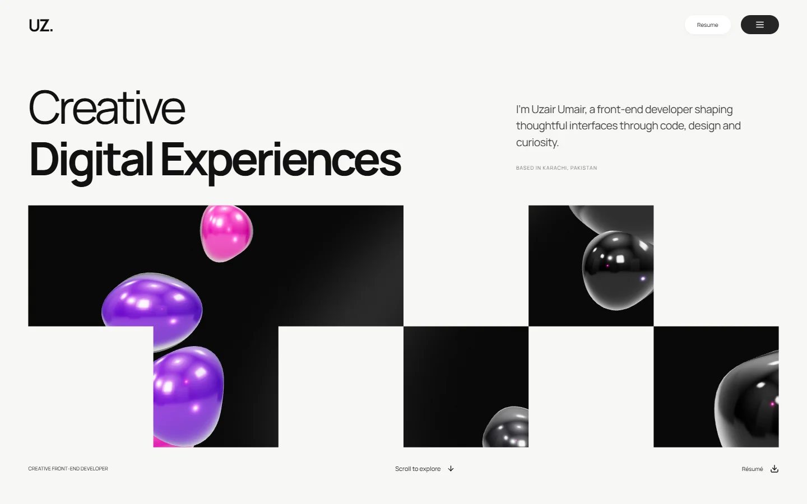

# Uzair M. Umair — Front-End Developer Portfolio

A personal portfolio showcasing practical front-end projects, ongoing MERN Stack learning, and selected graphic-design work.

Built with **React**, **Vite**, **JavaScript**, and **CSS**. The site keeps development work at the center, with a separate collection for graphic design.



## Highlights

- Five development projects with live links, technology filters and individual detail pages.
- Seven graphic-design entries covering Pure Roots mockups, posters, advertising and social-media graphics.
- Responsive layouts for mobile, tablet and desktop.
- Dark and light themes with a saved preference.
- Keyboard-accessible navigation, visible focus states and a modal image viewer.
- Current résumé available to view or download.
- Email, LinkedIn and WhatsApp contact links.
- A validated contact form that opens an email draft, with optional provider-backed delivery.
- Centralized content files for straightforward updates.

## Built with

| Layer | Technology |
| --- | --- |
| Interface | React 19 |
| Build tooling | Vite 8 |
| Language | JavaScript |
| Styling | Standard CSS with theme variables and media queries |
| Routing | React Router |
| Icons | Lucide React |
| Images | Optimized WebP assets |
| Hosting configuration | Vercel SPA rewrites |

No database is needed for the portfolio. The technologies used to build this repository are separate from the proficiency statements in the personal profile: MERN technologies are explicitly marked as **currently learning**.

## Getting started

Use Node.js **22.12 or newer** and npm.

1. Clone this repository using its GitHub clone URL, or download and extract the source.
2. Open a terminal in the repository root, where `package.json` is located.
3. Install dependencies and start the development server:

```sh
npm install
npm run dev
```

Open the URL printed in the terminal.

### Available commands

| Command | Purpose |
| --- | --- |
| `npm install` | Install dependencies |
| `npm ci` | Install the exact versions in the committed lockfile |
| `npm run dev` | Start the local development server |
| `npm run build` | Generate the production site in `dist/` |
| `npm run preview` | Preview the production build locally |

## Project structure

```text
public/
├── images/                 Project previews and full gallery images
├── resume/                 Current downloadable résumé
├── favicon.svg
├── robots.txt
└── sitemap.xml
src/
├── components/
│   ├── ContactForm.jsx      Validation and contact delivery behavior
│   └── Shared.jsx           Navigation, cards, gallery and footer
├── data/
│   ├── background.js       Training, experience and education
│   ├── designProjects.js   Graphic-design entries
│   ├── profile.js          Personal details and contact links
│   ├── projects.js         Development projects
│   └── skills.js           Core, learning and supporting skills
├── pages/
│   ├── Home.jsx            Homepage sections and portrait
│   └── Projects.jsx        Listings, detail pages and 404
├── styles/
│   └── global.css          Themes, components and responsive rules
├── App.jsx                 Routing, scrolling and browser metadata
└── main.jsx                Application entry point
```

## Featured development work

| Project | Focus | Live project |
| --- | --- | --- |
| FreelancerFlow | Clients, projects, tasks and invoices | [Open project](https://freelancer-flow-ruddy.vercel.app/) |
| CineVerse | Movie and TV discovery | [Open project](https://cineverse-uu.vercel.app/) |
| Pick & Wear | Lifestyle storefront | [Open project](https://pick-and-wear.vercel.app/) |
| My Blog App | React post creation, editing and reactions | [Open project](https://stately-tartufo-954fdc.netlify.app/) |
| Notes App | Notes and Firebase authentication | [Open project](https://magenta-florentine-24d311.netlify.app/) |

Each project entry describes features supported by its supplied source or public implementation. Project repository links are omitted until verified URLs are available.

## Customize the portfolio

| What to change | File |
| --- | --- |
| Name, introduction, portrait, email, WhatsApp and social links | `src/data/profile.js` |
| Main skills and supporting graphic-design skill | `src/data/skills.js` |
| Training, experience and education | `src/data/background.js` |
| Development project records | `src/data/projects.js` |
| Graphic-design records | `src/data/designProjects.js` |
| Colors, typography and responsive layout | `src/styles/global.css` |
| Homepage sections and portrait and preview selection | `src/pages/Home.jsx` |
| Résumé PDF | `public/resume/uzair-m-umair-resume.pdf` |

### Add a development project

Place its screenshot in `public/images/`, then add a record to `src/data/projects.js`:

```js
{
  id: 'project-slug',
  title: 'Project title',
  category: 'Project category',
  shortDescription: 'A short description of the project.',
  fullDescription: 'An overview of the verified implementation.',
  technologies: ['HTML5', 'CSS3', 'JavaScript'],
  coverImage: '/images/project.webp',
  screenshots: ['/images/project.webp'],
  liveUrl: 'https://your-project.example', // Replace with a working URL.
  githubUrl: '', // Add a repository URL when available.
  features: ['A feature implemented in the project'],
}
```

The card and detail page are generated from this record. The first four entries appear on the homepage. Technology filters currently include JavaScript, React and Firebase when represented; the filter allowlist is in `Projects.jsx`. Add the new public route to `public/sitemap.xml`.

### Add graphic-design work

Add optimized images to `public/images/`, then add a record to `src/data/designProjects.js` with `id`, `title`, `category`, `coverImage`, `gallery` and `description`.

Use a lightweight image for `coverImage` and a larger version for `gallery`. Category filters are generated from the records. All seven current entries appear in the homepage graphic-work section; the filterable collection is also available at `/design`. Add the new route to the sitemap.

Artwork is presented as visual work. Promotional wording inside assignment artwork is not evidence of actual client outcomes. Leave client names, tools and dates blank unless confirmed.

### Update the portrait

The hero uses the supplied portrait with responsive WebP versions. Replace public/images/uzair-portrait-560.webp and public/images/uzair-portrait-1000.webp, or update the portrait paths in src/data/profile.js. Framing and the subtle lower-edge blend are styled in global.css; the original portrait is not retouched.

### Replace the résumé

Replace `public/resume/uzair-m-umair-resume.pdf` using the same filename. All résumé buttons share this path through `profile.resume`. The PDF loads only when opened or downloaded.

### Update contact links

Edit `profile.js`. WhatsApp uses international digits without spaces or the leading local zero: `https://wa.me/923707429349`. The displayed local number is stored separately. Add only genuine URLs to the `socials` array.

## Contact form configuration

The default form validates the visitor's details and opens a draft in their email application. It does **not** send mail directly or show a false delivery confirmation.

To enable delivery through a compatible form provider:

1. Create and configure the provider's form and destination inbox.
2. Copy `.env.example` to `.env.local`.
3. Set its public endpoint:

```dotenv
VITE_CONTACT_ENDPOINT=https://your-provider.example/your-form-endpoint
```

The endpoint must accept cross-origin multipart `POST` requests and an `Accept: application/json` header. A successful HTTP response is treated as provider acceptance. Loading, success and failure states are implemented, together with a honeypot field.

Values beginning with `VITE_` are included in the browser bundle. Use only a public form endpoint; keep private credentials on the provider or server. Restart the development server after changing environment variables, and rebuild for production.

## Publish the source on GitHub

Create an empty GitHub repository, then run these commands from this project root. Replace `YOUR_GITHUB_REPOSITORY_URL` with the repository's real URL:

```sh
git init
git add .
git commit -m "Add personal front-end portfolio"
git branch -M main
git remote add origin YOUR_GITHUB_REPOSITORY_URL
git push -u origin main
```

If the folder is already a Git repository, use its existing history and remote configuration. Commit the lockfile. The `.gitignore` excludes dependencies, build output, local environment files and machine-specific QA helpers.

Publishing source on GitHub does not deploy the website. This project is configured for Vercel hosting; GitHub Pages would require separate routing and base-path configuration.

## Deploy on Vercel

1. Import the GitHub repository into Vercel.
2. Select the directory containing `package.json` as the Root Directory.
3. Use **Vite** as the framework preset, `npm run build` as the build command and `dist` as the output directory.
4. Add `VITE_CONTACT_ENDPOINT` only if delivery is configured.
5. Deploy and assign the desired domain.
6. Check a direct detail-page URL, the résumé download and contact behavior.

`vercel.json` supports direct visits and refreshes on application routes. The canonical URL currently points to the existing portfolio domain, `https://uzairumair.vercel.app`. When changing domains, update `profile.js`, `index.html`, `robots.txt` and `sitemap.xml` together.

Page titles and descriptions update in the browser. Crawlers that do not execute JavaScript receive the homepage metadata; page-specific social previews would require prerendering or server rendering.

## Accessibility and validation

The interface includes semantic landmarks, form labels, a skip link, visible focus indicators, reduced-motion support, keyboard-operable filters and native modal dialogs.

Validation has covered the production build, responsive widths from 320 px to 1920 px, navigation, theme persistence, project filtering, detail routes, gallery controls, form validation and résumé availability. No Lighthouse score or provider-delivery result is claimed.

## Contact

**Uzair M. Umair** — Front-End Developer, Karachi, Pakistan

- [Email](mailto:uzairprivv@gmail.com)
- [WhatsApp](https://wa.me/923707429349)
- [LinkedIn](https://www.linkedin.com/in/uzair-m-umair-53a778373)

## Content and reuse

This repository contains personal portfolio content, a résumé and graphic-design work. No open-source license is granted by this README. Contact the owner before reusing the artwork or personal content; third-party dependencies retain their respective licenses.


